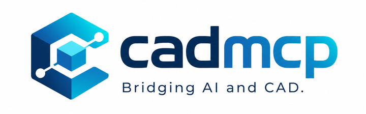
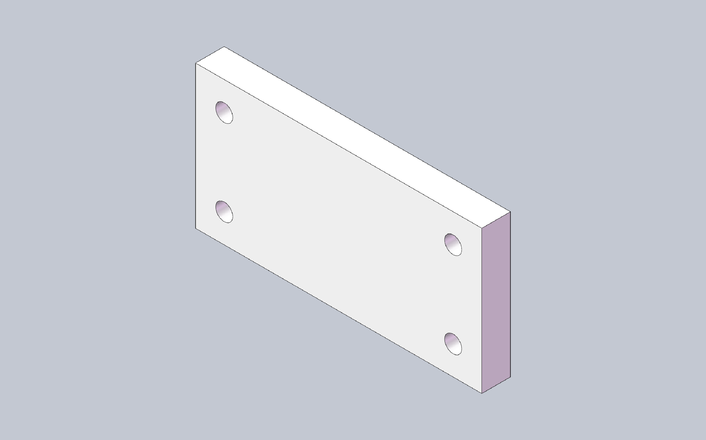

<p align="center">
  
</p>

# cadmcp

**Sprachen:** [English](README.md) · [简体中文](README.zh-CN.md) · [Deutsch](README.de.md) · [日本語](README.ja.md)

> **English README is authoritative; translations welcome via PR.**

Lassen Sie KI-Agenten (Cursor, Claude, VS Code, OpenCode) SolidWorks über MCP
steuern: Beschreiben Sie ein Bauteil in normaler Sprache, verfolgen Sie, wie
das Modell entsteht, und fragen Sie dann Masseneigenschaften ab, bauen Sie
Baugruppen, erstellen Sie Zeichnungen und Exporte — ohne den Chat zu verlassen.

[](https://github.com/pakupaku5260/cad-mcp/actions/workflows/ci.yml)
[](https://cad.npanic.com/)
[](https://pypi.org/project/pycadmcp/)
[](LICENSE)

**Docs (English):** [cad.npanic.com](https://cad.npanic.com/)

## Was es für Sie tun kann

- **Konversationelle Bauteilmodellierung** — Skizzen, Extrudieren, Verrunden,
  Bohrungsassistent, Gewinde, Sweeps: „eine 100×50×10-Platte mit vier
  Ø6-Durchgangsbohrungen" anfordern und Maße im Chat weiter anpassen.
- **Konstruktionszustand prüfen** — Masseneigenschaften, Geometrie,
  Bounding-Box, Featurebaum, Flächen-/Kantenabfragen.
- **Baugruppen** — Komponenten einfügen, Paarungen hinzufügen,
  Komponentenoperationen.
- **Zeichnungen & Blech** — Ansichten und Beschriftungen, DrawingSpec;
  Grundflansch / Hemmkante / Abwicklung.
- **Export** von STEP / STL / PDF / DXF direkt aus dem Gespräch.
- **Nicht stecken bleiben** — blockiert ein SolidWorks-Dialog die Sitzung,
  führen eingebaute Skills (`solidworks-modeling`, `solidworks-assembly`,
  `solidworks-recovery`) und `cadmcp doctor` den Agenten durch die Wiederherstellung.

## Quickstart-Demo



Prompt: *„Erstelle eine 100×50×10-mm-Platte mit vier Ø6-Durchgangsbohrungen in
den Ecken."* Der Agent rief diese Werkzeuge auf (echte Sitzung):

```text
new_part            {}
start_sketch        {"plane": "Front Plane"}
sketch_rectangle    {"x1": 0, "y1": 0, "x2": 100, "y2": 50}
end_sketch          {}
extrude             {"depth": 10}
hole_wizard         {"face": 4, "diameter": 6, "end": "through_all", "x": 10, "y": 10}
hole_wizard         {"face": 4, "diameter": 6, "end": "through_all", "x": 90, "y": 10}
hole_wizard         {"face": 4, "diameter": 6, "end": "through_all", "x": 10, "y": 40}
hole_wizard         {"face": 4, "diameter": 6, "end": "through_all", "x": 90, "y": 40}
get_mass_properties {}
```

`get_mass_properties` meldet 48.869 mm³ — 50.000 minus vier Ø6-Bohrungen,
exakt wie angefordert.

## Voraussetzungen

| Setup | Benötigt |
|---|---|
| **SolidWorks-Backend** (echte Modellierung) | Windows + laufendes SolidWorks **2025** + Python 3.11+ + `pywin32` |
| **Fake-Backend** (MCP-Verkabelung ohne SolidWorks testen) | Python 3.11+, jedes OS — nur Konnektivitätsprüfung, keine echte Modellierung |

## Installation

```bash
pip install pycadmcp
```

CLI-Einstiegspunkt: `cadmcp`.

## Mit einem KI-Client verbinden

Beide Transporte werden unterstützt: **stdio** (der Client startet den Server —
empfohlen für Editoren und Agenten) und **HTTP** (ein dauerhaft laufender
lokaler Server; auch praktisch für Debugging und Monitoring).

### stdio (empfohlen)

Ein Befehl schreibt den Servereintrag für Cursor, Claude Desktop, VS Code oder
OpenCode:

```bash
cadmcp install --client cursor      # oder: claude | vscode | opencode
cadmcp install --client cursor --dry-run
```

Das schreibt einen Servereintrag namens `solidworks`. Entsprechende manuelle JSON:

```json
{
  "mcpServers": {
    "solidworks": {
      "command": "cadmcp",
      "args": ["serve", "--transport", "stdio", "--backend", "solidworks", "--profile", "part"]
    }
  }
}
```

Ohne installiertes SolidWorks `"--backend", "fake"` verwenden.

### HTTP (Streamable HTTP)

Server einmal starten und URL-basierte Clients darauf richten:

```bash
cadmcp serve --transport http --backend solidworks
# lauscht auf 127.0.0.1:8756 — MCP-Endpunkt http://127.0.0.1:8756/mcp
```

- HTTP ist standardmäßig authentifiziert: Ein Token wird automatisch erzeugt
  unter `%APPDATA%\cadmcp\token` (Windows) bzw. `~/.config/cadmcp/token`
  (POSIX); senden Sie es als `Authorization: Bearer <token>`.
- `--host` / `--port` passen die Bindung an; `--allow-insecure` deaktiviert
  Authentifizierung nur auf Loopback (Nicht-Loopback-Bindungen verlangen
  stets das Token).
- `GET /health` liefert den Executor-Zustand zum Monitoring (ohne Auth).

JSON für URL-basierte Clients:

```json
{
  "mcpServers": {
    "solidworks": {
      "url": "http://127.0.0.1:8756/mcp",
      "headers": { "Authorization": "Bearer <token>" }
    }
  }
}
```

### Erstes Ergebnis — und bei Blockaden

Client neu starten, einen Chat öffnen und die Demo-Aufgabe oben stellen.
Gesundheitscheck: `cadmcp doctor --backend solidworks` (oder `--backend fake`
ohne SolidWorks). Meldet der Agent einen hängenden Executor, lassen Sie ihn
`cadmcp doctor` ausführen — der Recovery-Skill
(`cadmcp://skill/solidworks-recovery`) führt durch das Aufräumen von
SolidWorks-Dialogen.

Optionale skriptgesteuerte Demo (aus einem Repo-Klon): `examples/box_recipe.json`
in den Arbeitsbereich kopieren und `replay_recipe` ausführen.

## Funktionsübersicht

**134 Werkzeuge** in 9 Toolsets (siehe [docs/TOOL_INVENTORY.md](docs/TOOL_INVENTORY.md)):

| Toolset | Anzahl | Schwerpunkt |
|---|---|---|
| core | 45 | Dokumente, Skizzen, Grundfeatures, Abfragen |
| features_adv | 25 | Gewinde, Helix, Sweep, Flächen, Feature-Operationen |
| assembly | 20 | Einfügen, Paarungen, Komponentenoperationen |
| drawing | 16 | Ansichten, Beschriftungen, DrawingSpec |
| sketch_adv | 12 | Splines, Versatz/Trimmen, Bedingungen, Maße |
| sheetmetal | 7 | Grundflansch/Hemmkante, Abwicklung |
| selection | 6 | Flächen-/Kanten-Auswahlhilfen |
| view | 2 | Ausrichtungen / Screenshots |
| export | 1 | STEP/STL/PDF/DXF |

Skills (`solidworks-modeling`, `solidworks-assembly`, `solidworks-recovery`)
werden als `cadmcp://skill/...`-Ressourcen ausgeliefert. `solidworks-modeling`
ist zusätzlich eigenständig auf
[Agensi](https://www.agensi.io/skills/solidworks-modeling) veröffentlicht.

## Bekannte Einschränkungen

| Einschränkung | Hinweise |
|---|---|
| Formkern/Kavität | Blockiert bis zuverlässige Trennflächen / Lizenzkontext — [#1](https://github.com/pakupaku5260/cad-mcp/issues/1) |
| Native InsertThread-API | Stattdessen Helix + Sweep-Cut — [#2](https://github.com/pakupaku5260/cad-mcp/issues/2) |
| SolidWorks Toolbox | Nicht integriert — [#3](https://github.com/pakupaku5260/cad-mcp/issues/3) |
| Bauteilbearbeitung im Kontext (`EditPart2`) | Nicht unterstützt; Teilbaugruppenbearbeitung ja — [#4](https://github.com/pakupaku5260/cad-mcp/issues/4) |
| Axiale Schraub-/Vorschub-Paarungsbewegung | Nicht unterstützt |

## Architektur in drei Fakten

- SolidWorks-COM läuft nur auf einem dedizierten **STA-Thread**;
  Anwendungscode baut nie selbst COM-Verbindungen auf.
- Ein offline testbares **Fake-Backend** implementiert dasselbe Protokoll —
  die gesamte Testsuite läuft ohne SolidWorks.
- Jedes Werkzeug liefert einen typisierten **OpResult**-Umschlag
  (`ok` / `error.code` / `delta` / `state_version`).

Details: [ARCHITECTURE.md](ARCHITECTURE.md). Namenshistorie: [docs/naming.md](docs/naming.md).

## Entwicklung

```bash
git clone https://github.com/pakupaku5260/cad-mcp.git
cd cad-mcp
pip install -e ".[dev]"
```

Offline-Tests, das Architektur-Gate, HTTP-Debugging und (destruktive)
Real-SolidWorks-Testläufe sind in [CONTRIBUTING.md](CONTRIBUTING.md)
beschrieben; das Systemdesign in [ARCHITECTURE.md](ARCHITECTURE.md).

## Lizenz

[MIT](LICENSE) — Copyright (c) 2026 pakupaku5260.

Unabhängiges Projekt, nicht verbunden mit Dassault Systèmes · SOLIDWORKS® ist eine
eingetragene Marke der Dassault Systèmes SolidWorks Corporation.
