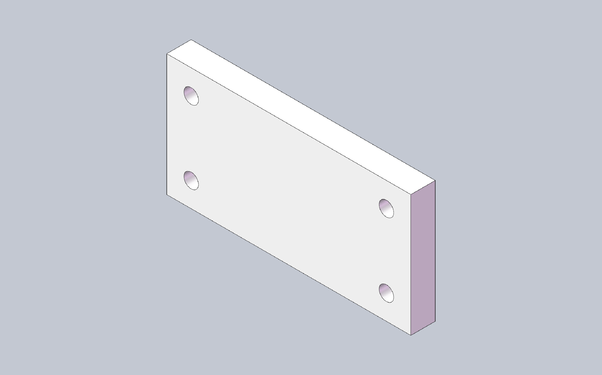

# cadmcp

**言語:** [English](README.md) · [简体中文](README.zh-CN.md) · [Deutsch](README.de.md) · [日本語](README.ja.md)

> **English README is authoritative; translations welcome via PR.**

AI エージェント（Cursor、Claude、VS Code、OpenCode）に MCP 経由で
SolidWorks を操作させましょう：自然言語で部品を記述し、モデルが組み上がる
様子を見守り、質量プロパティの照会、アセンブリ、図面作成、エクスポートまで
— チャットから出ることなく完結します。

[](https://github.com/pakupaku5260/cad-mcp/actions/workflows/ci.yml)
[](https://cad.npanic.com/)
[](https://pypi.org/project/pycadmcp/)
[](LICENSE)

**Docs（英語）:** [cad.npanic.com](https://cad.npanic.com/)

## できること

- **対話型の部品モデリング** — スケッチ、押出、フィレット、穴ウィザード、
  ねじ、スイープ：「100×50×10 の板に 4 つの Ø6 貫通穴」と頼み、チャットで
  寸法を続けて調整。
- **設計状態の確認** — 質量プロパティ、ジオメトリ、バウンディングボックス、
  フィーチャツリー、面／辺の照会。
- **アセンブリ** — コンポーネント挿入、メイト追加、コンポーネント操作。
- **図面と板金** — ビューと注記、DrawingSpec；ベースフランジ／ヘム／平板展開。
- **エクスポート** STEP / STL / PDF / DXF を会話の中から実行。
- **詰まらない** — SolidWorks のダイアログでセッションが止まっても、内蔵
  スキル（`solidworks-modeling`、`solidworks-assembly`、`solidworks-recovery`）
  と `cadmcp doctor` がエージェントを回復へ導きます。

## クイックスタートデモ



プロンプト：*「100×50×10 mm の板を作り、四隅に Ø6 の貫通穴を開けて。」*
エージェントが発行した呼び出し（実際のセッション）：

```text
new_part            {}
start_sketch        {"plane": "Front Plane"}
sketch_rectangle    {"x1": 0, "y1": 0, "x2": 100, "y2": 50}
end_sketch          {}
extrude             {"depth": 10}
hole_wizard         {"face": 4, "diameter": 6, "end": "through_all", "x": 10, "y": 10}
hole_wizard         {"face": 4, "diameter": 6, "end": "through_all", "x": 90, "y": 10}
hole_wizard         {"face": 4, "diameter": 6, "end": "through_all", "x": 10, "y": 40}
hole_wizard         {"face": 4, "diameter": 6, "end": "through_all", "x": 90, "y": 40}
get_mass_properties {}
```

`get_mass_properties` は 48,869 mm³ を返します — 50,000 から 4 つの Ø6 穴を
差し引いた値で、要求どおりです。

## 動作環境

| 構成 | 必要なもの |
|---|---|
| **SolidWorks バックエンド**（実際のモデリング） | Windows + 実行中の SolidWorks **2025** + Python 3.11+ + `pywin32` |
| **Fake バックエンド**（SolidWorks 無しで MCP 接続を確認） | Python 3.11+、任意の OS — 接続確認のみ、実際のモデリングは不可 |

## インストール

```bash
pip install pycadmcp
```

CLI エントリーポイント：`cadmcp`。

## AI クライアントへの接続

2 つのトランスポートに対応します：**stdio**（クライアントがサーバーを起動 —
エディタ／エージェント向けに推奨）と **HTTP**（常駐のローカルサーバー；
デバッグやモニタリングにも便利）。

### stdio（推奨）

コマンド 1 つで Cursor、Claude Desktop、VS Code、OpenCode にサーバー設定を
書き込みます：

```bash
cadmcp install --client cursor      # または：claude | vscode | opencode
cadmcp install --client cursor --dry-run
```

`solidworks` という名前のサーバーエントリが書き込まれます。同等の手動 JSON：

```json
{
  "mcpServers": {
    "solidworks": {
      "command": "cadmcp",
      "args": ["serve", "--transport", "stdio", "--backend", "solidworks", "--profile", "part"]
    }
  }
}
```

SolidWorks が未インストールの場合は `"--backend", "fake"` を使います。

### HTTP（Streamable HTTP）

サーバーを一度起動し、URL ベースのクライアントから接続します：

```bash
cadmcp serve --transport http --backend solidworks
# 127.0.0.1:8756 で待機 — MCP エンドポイント http://127.0.0.1:8756/mcp
```

- HTTP は既定で認証付き：トークンは初回起動時に自動生成され、
  `%APPDATA%\cadmcp\token`（Windows）または `~/.config/cadmcp/token`
  （POSIX）に置かれます。`Authorization: Bearer <token>` として送信します。
- `--host` / `--port` でバインドを調整；`--allow-insecure` はループバックでのみ
  認証を無効化できます（非ループバックのバインドには必ずトークンが必要）。
- `GET /health` はモニタリング用に実行器の状態を返します（認証不要）。

URL ベースのクライアント用の設定：

```json
{
  "mcpServers": {
    "solidworks": {
      "url": "http://127.0.0.1:8756/mcp",
      "headers": { "Authorization": "Bearer <token>" }
    }
  }
}
```

### 最初の結果と、詰まったとき

クライアントを再起動し、チャットを開いて上のデモと同じ内容を頼むだけです。
ヘルスチェック：`cadmcp doctor --backend solidworks`（SolidWorks がない場合は
`--backend fake`）。エージェントが実行器のスタックを報告したら、
`cadmcp doctor` を実らせてください — リカバリースキル
（`cadmcp://skill/solidworks-recovery`）が SolidWorks ダイアログの解消を案内します。

任意のスクリプトデモ（リポジトリをクローンした場合）：`examples/box_recipe.json`
をワークスペースにコピーして `replay_recipe` を実行。

## 機能の概要

**134 個のツール**、9 個のツールセット（[docs/TOOL_INVENTORY.md](docs/TOOL_INVENTORY.md) 参照）：

| ツールセット | 数 | 重点 |
|---|---|---|
| core | 45 | ドキュメント、スケッチ、基本フィーチャー、照会 |
| features_adv | 25 | ねじ、ヘリックス、スイープ、サーフェス、フィーチャー操作 |
| assembly | 20 | 挿入、メイト、コンポーネント操作 |
| drawing | 16 | ビュー、注記、DrawingSpec |
| sketch_adv | 12 | スプライン、オフセット／トリム、拘束、寸法 |
| sheetmetal | 7 | ベースフランジ／ヘム、平板展開 |
| selection | 6 | 面／辺の選択ヘルパー |
| view | 2 | 視点 / スクリーンショット |
| export | 1 | STEP/STL/PDF/DXF |

スキル（`solidworks-modeling`、`solidworks-assembly`、`solidworks-recovery`）は
`cadmcp://skill/...` リソースとして同梱されます。

## 既知の制限

| 制限 | 備考 |
|---|---|
| モールドコア／キャビティ | パーティング面の信頼性／ライセンス状況待ち — [#1](https://github.com/pakupaku5260/cad-mcp/issues/1) |
| ネイティブ InsertThread API | 代わりにヘリックス＋スイープカットを使用 — [#2](https://github.com/pakupaku5260/cad-mcp/issues/2) |
| SolidWorks Toolbox | 未統合 — [#3](https://github.com/pakupaku5260/cad-mcp/issues/3) |
| 部品の文脈内編集（`EditPart2`） | 非対応；サブアセンブリ編集は対応 — [#4](https://github.com/pakupaku5260/cad-mcp/issues/4) |
| 軸方向ねじ込み／フィードのメイト動作 | 非対応 |

## アーキテクチャの 3 事実

- SolidWorks COM は専用の **STA スレッド**でのみ動作。ビジネスコードは
  自分で COM 接続を作りません。
- オフライン検証可能な **Fake バックエンド**が同じプロトコルを実装し、
  全テストスイートは SolidWorks なしで動きます。
- 各ツールは型付きの **OpResult** エンベロープ（`ok` / `error.code` /
  `delta` / `state_version`）を返します。

詳細は [ARCHITECTURE.md](ARCHITECTURE.md)。命名の歴史：[docs/naming.md](docs/naming.md)。

## 開発

```bash
git clone https://github.com/pakupaku5260/cad-mcp.git
cd cad-mcp
pip install -e ".[dev]"
```

オフラインテスト、アーキテクチャゲート、HTTP デバッグ、（破壊的な）
実機 SolidWorks テストは [CONTRIBUTING.md](CONTRIBUTING.md) に、
システム設計は [ARCHITECTURE.md](ARCHITECTURE.md) にあります。

## ライセンス

[MIT](LICENSE) — Copyright (c) 2026 pakupaku5260.

独立したプロジェクトで、Dassault Systèmes とは無関係です · SOLIDWORKS® は
Dassault Systèmes SolidWorks Corporation の登録商標です。
