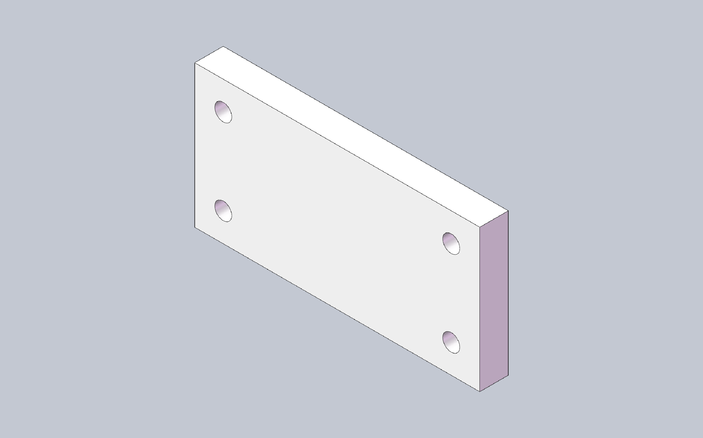

# cadmcp

**Languages:** [English](README.md) · [简体中文](README.zh-CN.md) · [Deutsch](README.de.md) · [日本語](README.ja.md)

Let AI agents (Cursor, Claude, VS Code, OpenCode) drive SolidWorks over MCP:
describe a part in plain language, watch the model build, then query mass
properties, assemble, detail, and export — without leaving the chat.

[](https://github.com/pakupaku5260/cad-mcp/actions/workflows/ci.yml)
[](https://cad.npanic.com/)
[](https://pypi.org/project/pycadmcp/)
[](LICENSE)

**Docs:** [cad.npanic.com](https://cad.npanic.com/) — getting started, tools, architecture, FAQ.

## What it can do for you

- **Conversational part modeling** — sketch, extrude, fillet, hole wizard,
  threads, sweeps: ask for "a 100×50×10 plate with four Ø6 through holes" and
  iterate on dimensions in chat.
- **Inspect design state** — mass properties, geometry, bounding box, feature
  tree, face/edge queries.
- **Assemblies** — insert components, add mates, component operations.
- **Drawings & sheet metal** — views and annotations, DrawingSpec; base
  flange / hem / flat pattern.
- **Export** STEP / STL / PDF / DXF from the conversation.
- **Stay unblocked** — when a SolidWorks dialog stalls the session, built-in
  skills (`solidworks-modeling`, `solidworks-assembly`, `solidworks-recovery`)
  and `cadmcp doctor` guide the agent through recovery.

## Quickstart demo



Prompt: *"Create a 100×50×10 mm plate with four Ø6 through holes at the
corners."* The agent made these calls (real session):

```text
new_part            {}
start_sketch        {"plane": "Front Plane"}
sketch_rectangle    {"x1": 0, "y1": 0, "x2": 100, "y2": 50}
end_sketch          {}
extrude             {"depth": 10}
hole_wizard         {"face": 4, "diameter": 6, "end": "through_all", "x": 10, "y": 10}
hole_wizard         {"face": 4, "diameter": 6, "end": "through_all", "x": 90, "y": 10}
hole_wizard         {"face": 4, "diameter": 6, "end": "through_all", "x": 10, "y": 40}
hole_wizard         {"face": 4, "diameter": 6, "end": "through_all", "x": 90, "y": 40}
get_mass_properties {}
```

`get_mass_properties` reports 48,869 mm³ — 50,000 minus four Ø6 holes, exactly
as requested.

## Requirements

| Setup | Needs |
|---|---|
| **SolidWorks backend** (real modeling) | Windows + SolidWorks **2025** running + Python 3.11+ + `pywin32` |
| **Fake backend** (try MCP wiring without SolidWorks) | Python 3.11+, any OS — connectivity check only, no real modeling |

## Install

```bash
pip install pycadmcp
```

CLI entry point: `cadmcp`.

## Connect to an AI client

Both transports are supported: **stdio** (the client spawns the server —
recommended for editors and agents) and **HTTP** (a long-running local server;
also handy for debugging and monitoring).

### stdio (recommended)

One command writes the server entry for Cursor, Claude Desktop, VS Code, or
OpenCode:

```bash
cadmcp install --client cursor      # or: claude | vscode | opencode
cadmcp install --client cursor --dry-run
```

That writes a server entry named `solidworks`. Equivalent manual JSON:

```json
{
  "mcpServers": {
    "solidworks": {
      "command": "cadmcp",
      "args": ["serve", "--transport", "stdio", "--backend", "solidworks", "--profile", "part"]
    }
  }
}
```

Use `"--backend", "fake"` when SolidWorks is not installed.

### HTTP (Streamable HTTP)

Start the server once and point URL-based clients at it:

```bash
cadmcp serve --transport http --backend solidworks
# listens on 127.0.0.1:8756 — MCP endpoint http://127.0.0.1:8756/mcp
```

- HTTP is authenticated by default: a token is auto-created at
  `%APPDATA%\cadmcp\token` (Windows) or `~/.config/cadmcp/token` (POSIX);
  send it as `Authorization: Bearer <token>`.
- `--host` / `--port` adjust the bind; `--allow-insecure` disables auth on
  loopback only (non-loopback binds always require the token).
- `GET /health` returns executor state for monitoring (no auth required).

Client config for URL-based clients:

```json
{
  "mcpServers": {
    "solidworks": {
      "url": "http://127.0.0.1:8756/mcp",
      "headers": { "Authorization": "Bearer <token>" }
    }
  }
}
```

### First result, and when things stall

Restart the client, open a chat, and ask for the plate from the demo above.
Health check: `cadmcp doctor --backend solidworks` (or `--backend fake`
without SolidWorks). If the agent reports a stuck executor, ask it to run
`cadmcp doctor` — the recovery skill (`cadmcp://skill/solidworks-recovery`)
walks through clearing SolidWorks dialogs.

Optional scripted demo (from a repo clone): copy `examples/box_recipe.json`
into the workspace and run `replay_recipe`.

## Capability overview

**134 tools** across 9 toolsets (see [docs/TOOL_INVENTORY.md](docs/TOOL_INVENTORY.md)):

| Toolset | Count | Focus |
|---|---|---|
| core | 45 | Documents, sketches, basic features, queries |
| features_adv | 25 | Thread, helix, sweep, surfaces, feature ops |
| assembly | 20 | Insert, mates, component ops |
| drawing | 16 | Views, annotations, DrawingSpec |
| sketch_adv | 12 | Splines, offset/trim, constraints, dims |
| sheetmetal | 7 | Base/flange/hem, flat pattern |
| selection | 6 | Face/edge pick helpers |
| view | 2 | Orientations / screenshots |
| export | 1 | STEP/STL/PDF/DXF |

Skills (`solidworks-modeling`, `solidworks-assembly`, `solidworks-recovery`)
ship as `cadmcp://skill/...` resources.

## Known limitations

| Limitation | Notes |
|---|---|
| Mold Core/Cavity | Blocked pending reliable parting-surface / license context — [#1](https://github.com/pakupaku5260/cad-mcp/issues/1) |
| Native InsertThread API | Helix + sweep cut path is used instead — [#2](https://github.com/pakupaku5260/cad-mcp/issues/2) |
| SolidWorks Toolbox | Not integrated — [#3](https://github.com/pakupaku5260/cad-mcp/issues/3) |
| Part in-context edit (`EditPart2`) | Not supported; subassembly edit is — [#4](https://github.com/pakupaku5260/cad-mcp/issues/4) |
| Axial screw-in / feed mate motion | Not supported |

## Architecture in three facts

- SolidWorks COM runs only on a dedicated **STA thread**; business code never
  creates COM connections itself.
- An offline-testable **Fake backend** implements the same protocol, so the
  full test suite runs without SolidWorks.
- Every tool returns a typed **OpResult** envelope (`ok` / `error.code` /
  `delta` / `state_version`).

Details: [ARCHITECTURE.md](ARCHITECTURE.md). Naming history: [docs/naming.md](docs/naming.md).

## Development

```bash
git clone https://github.com/pakupaku5260/cad-mcp.git
cd cad-mcp
pip install -e ".[dev]"
```

Offline tests, the architecture gate, HTTP debugging, and (destructive)
real-SolidWorks test runs are documented in
[CONTRIBUTING.md](CONTRIBUTING.md); system design in
[ARCHITECTURE.md](ARCHITECTURE.md).

## License

[MIT](LICENSE) — Copyright (c) 2026 pakupaku5260.

Independent project, not affiliated with Dassault Systèmes · SOLIDWORKS® is a
registered trademark of Dassault Systèmes SolidWorks Corporation.
