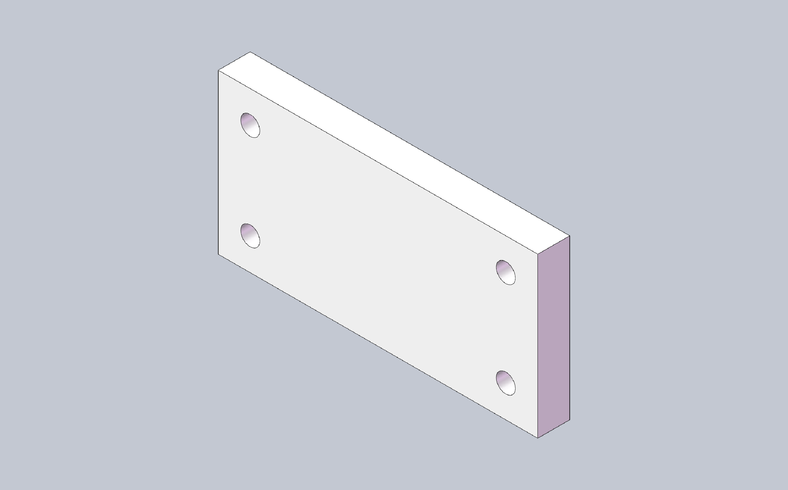

# cadmcp

**语言：** [English](README.md) · [简体中文](README.zh-CN.md) · [Deutsch](README.de.md) · [日本語](README.ja.md)

> 语义以 [英文 README](README.md) 为准；本页为中文译本。

让 AI 代理（Cursor、Claude、VS Code、OpenCode）通过 MCP 驱动 SolidWorks：
用自然语言描述零件，看着模型在 SolidWorks 里成形，然后查询质量属性、
装配、出图、导出——全程不用离开对话。

> **与达索系统无附属关系。** SolidWorks® 为达索系统或其子公司商标。本项目为独立社区 MCP 服务器。

[](https://github.com/pakupaku5260/cad-mcp/actions/workflows/ci.yml)
[](https://pakupaku5260.github.io/cad-mcp/)
[](https://pypi.org/project/pycadmcp/)
[](LICENSE)

**文档站点（英文）：** [pakupaku5260.github.io/cad-mcp](https://pakupaku5260.github.io/cad-mcp/)

## 它能帮你做什么

- **对话式零件建模** — 草图、拉伸、圆角、孔向导、螺纹、扫描：
  说一句「一块 100×50×10 的板，四个 Ø6 通孔」，再在对话里继续改尺寸。
- **检查设计状态** — 质量属性、几何、包围盒、特征树、面/边查询。
- **装配体** — 插入零部件、添加配合、零部件操作。
- **工程图与钣金** — 视图与注解、DrawingSpec；基体法兰 / 折弯边 / 展平。
- **导出** STEP / STL / PDF / DXF，直接在对话里完成。
- **卡住也能继续** — SolidWorks 对话框阻塞会话时，内置技能
  （`solidworks-modeling`、`solidworks-assembly`、`solidworks-recovery`）
  和 `cadmcp doctor` 会引导代理完成恢复。

## 快速上手演示



提示词：*「创建一块 100×50×10 mm 的板，四角打 Ø6 通孔。」*
代理实际发出的调用（真实会话）：

```text
new_part            {}
start_sketch        {"plane": "Front Plane"}
sketch_rectangle    {"x1": 0, "y1": 0, "x2": 100, "y2": 50}
end_sketch          {}
extrude             {"depth": 10}
hole_wizard         {"face": 4, "diameter": 6, "end": "through_all", "x": 10, "y": 10}
hole_wizard         {"face": 4, "diameter": 6, "end": "through_all", "x": 90, "y": 10}
hole_wizard         {"face": 4, "diameter": 6, "end": "through_all", "x": 10, "y": 40}
hole_wizard         {"face": 4, "diameter": 6, "end": "through_all", "x": 90, "y": 40}
get_mass_properties {}
```

`get_mass_properties` 返回 48,869 mm³——50,000 减去四个 Ø6 孔，与要求完全一致。

## 环境要求

| 配置 | 需要 |
|---|---|
| **SolidWorks 后端**（真实建模） | Windows + 运行中的 SolidWorks **2025** + Python 3.11+ + `pywin32` |
| **Fake 后端**（无 SolidWorks 时试通 MCP 链路） | Python 3.11+，任意系统——仅验证连通，不做真实建模 |

## 安装

```bash
pip install pycadmcp
```

CLI 入口：`cadmcp`。

## 接入 AI 客户端

两种传输方式均受支持：**stdio**（由客户端拉起服务器进程——编辑器/代理推荐）
与 **HTTP**（常驻本地服务器；也便于调试与监控）。

### stdio（推荐）

一条命令即可写入 Cursor、Claude Desktop、VS Code 或 OpenCode 的服务器配置：

```bash
cadmcp install --client cursor      # 或：claude | vscode | opencode
cadmcp install --client cursor --dry-run
```

写入名为 `solidworks` 的服务器条目。等效手动 JSON：

```json
{
  "mcpServers": {
    "solidworks": {
      "command": "cadmcp",
      "args": ["serve", "--transport", "stdio", "--backend", "solidworks", "--profile", "part"]
    }
  }
}
```

未安装 SolidWorks 时用 `"--backend", "fake"`。

### HTTP（Streamable HTTP）

启动一次服务器，把基于 URL 的客户端指向它：

```bash
cadmcp serve --transport http --backend solidworks
# 监听 127.0.0.1:8756 —— MCP 端点 http://127.0.0.1:8756/mcp
```

- HTTP 默认启用认证：首次启动自动生成 token，位于
  `%APPDATA%\cadmcp\token`（Windows）或 `~/.config/cadmcp/token`（POSIX）；
  请求时以 `Authorization: Bearer <token>` 发送。
- `--host` / `--port` 调整监听地址；`--allow-insecure` 仅允许在回环地址上
  关闭认证（非回环绑定始终要求 token）。
- `GET /health` 返回执行器状态用于监控（无需认证）。

基于 URL 的客户端配置：

```json
{
  "mcpServers": {
    "solidworks": {
      "url": "http://127.0.0.1:8756/mcp",
      "headers": { "Authorization": "Bearer <token>" }
    }
  }
}
```

### 第一个结果，以及卡住时怎么办

重启客户端，打开对话，复述演示里的要求即可。健康检查：
`cadmcp doctor --backend solidworks`（无 SolidWorks 时用 `--backend fake`）。
代理报告执行器卡住时，让它运行 `cadmcp doctor`——恢复技能
（`cadmcp://skill/solidworks-recovery`）会引导清理 SolidWorks 弹窗。

可选脚本演示（需 clone 仓库）：把 `examples/box_recipe.json` 复制进工作区，
运行 `replay_recipe`。

## 能力概览

**134 个工具**，9 个工具集（见 [docs/TOOL_INVENTORY.md](docs/TOOL_INVENTORY.md)）：

| 工具集 | 数量 | 方向 |
|---|---|---|
| core | 45 | 文档、草图、基础特征、查询 |
| features_adv | 25 | 螺纹、螺旋线、扫描、曲面、特征操作 |
| assembly | 20 | 插入、配合、零部件操作 |
| drawing | 16 | 视图、注解、DrawingSpec |
| sketch_adv | 12 | 样条、偏移/裁剪、约束、尺寸 |
| sheetmetal | 7 | 基体法兰/折弯边、展平 |
| selection | 6 | 面/边拾取辅助 |
| view | 2 | 定向 / 截图 |
| export | 1 | STEP/STL/PDF/DXF |

技能（`solidworks-modeling`、`solidworks-assembly`、`solidworks-recovery`）
以 `cadmcp://skill/...` 资源形式分发。

## 已知限制

| 限制 | 说明 |
|---|---|
| 模具型芯/型腔 | 受分型面可靠性 / 许可上下文阻塞 — [#1](https://github.com/pakupaku5260/cad-mcp/issues/1) |
| 原生 InsertThread API | 改用螺旋线 + 扫描切除路径 — [#2](https://github.com/pakupaku5260/cad-mcp/issues/2) |
| SolidWorks Toolbox | 未集成 — [#3](https://github.com/pakupaku5260/cad-mcp/issues/3) |
| 零件关联编辑（`EditPart2`） | 不支持；子装配体编辑支持 — [#4](https://github.com/pakupaku5260/cad-mcp/issues/4) |
| 轴向旋入 / 进给配合运动 | 不支持 |

## 架构三事

- SolidWorks COM 仅在专用 **STA 线程**上运行；业务代码从不自建 COM 连接。
- 可离线测试的 **Fake 后端**实现同一协议，完整测试套件无需 SolidWorks。
- 每个工具返回类型化的 **OpResult** 封装（`ok` / `error.code` / `delta` /
  `state_version`）。

详见 [ARCHITECTURE.md](ARCHITECTURE.md)。命名沿革：[docs/naming.md](docs/naming.md)。

## 开发

```bash
git clone https://github.com/pakupaku5260/cad-mcp.git
cd cad-mcp
pip install -e ".[dev]"
```

离线测试、架构门禁、HTTP 调试与（破坏性的）真机测试见
[CONTRIBUTING.md](CONTRIBUTING.md)；系统设计见 [ARCHITECTURE.md](ARCHITECTURE.md)。

## 许可证

[MIT](LICENSE) — Copyright (c) 2026 pakupaku5260.

与达索系统无附属关系。SolidWorks® 为达索系统或其子公司商标。
