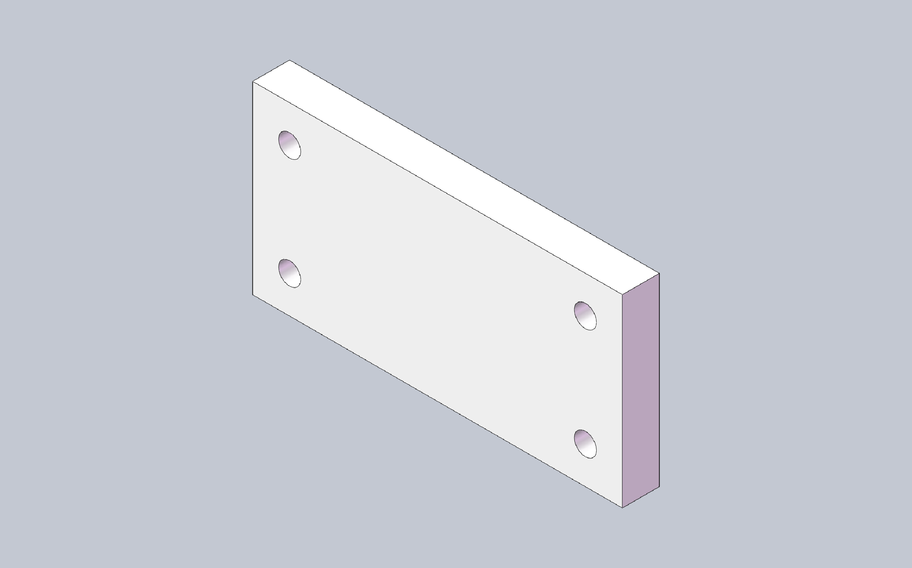

## Start here

Five minutes to a working MCP client. The first two commands need no CAD install:

```bash
pip install pycadmcp
cadmcp doctor --backend fake
cadmcp install --client cursor      # or: claude | vscode | opencode
```

For real geometry, run SolidWorks 2025 on Windows and switch the backend to
`solidworks`.

[Full quick start →](getting-started.md)

## See it build

<div class="grid cards" markdown>

-   :material-camera: **Real session, not a mockup**

    ---

    

    Prompt: *"Create a 100×50×10 mm plate with four Ø6 through holes at the
    corners."* Built through MCP in SolidWorks 2025.

-   :material-code-braces: **What the agent called**

    ---

    ```text
    new_part            {}
    start_sketch        {"plane": "Front Plane"}
    sketch_rectangle    {"x1": 0, "y1": 0, "x2": 100, "y2": 50}
    end_sketch          {}
    extrude             {"depth": 10}
    hole_wizard         {"face": 4, "diameter": 6, "end": "through_all", "x": 10, "y": 10}
    hole_wizard         {"face": 4, "diameter": 6, "end": "through_all", "x": 90, "y": 10}
    hole_wizard         {"face": 4, "diameter": 6, "end": "through_all", "x": 10, "y": 40}
    hole_wizard         {"face": 4, "diameter": 6, "end": "through_all", "x": 90, "y": 40}
    get_mass_properties {}
    ```

    `get_mass_properties` reports 48,869 mm³ — 50,000 minus four Ø6 holes,
    exactly as requested.

</div>

## Two ways to work

<div class="grid cards" markdown>

-   :material-test-tube: **Fake backend**

    ---

    Develop and verify offline on Windows, macOS, or Linux. The full test suite
    runs against Fake — try the tools before attaching to a live CAD session.

-   :material-desktop-classic: **Live CAD backend**

    ---

    Attach to a running CAD application on Windows. COM runs only on a dedicated
    STA thread; business code never opens COM itself. SolidWorks 2025 is
    supported today.

</div>

## Why cadmcp

<div class="grid cards" markdown>

-   :material-creation: **AI-assisted design**

    ---

    Your MCP client calls modeling tools step by step — intent in chat, geometry
    in CAD.

-   :material-cpu-64-bit: **STA by design**

    ---

    One process, one dedicated STA executor. No cross-thread COM objects.

-   :material-puzzle: **Every CAD domain**

    ---

    Sketches, features, assemblies, drawings, sheet metal, export — one MCP
    surface. See [tools](tools.md) for the matrix and profiles.

-   :material-connection: **Your MCP client**

    ---

    OpenCode, Cursor, Claude Desktop, VS Code, and other MCP hosts. Skills ship
    as `cadmcp://skill/...`.

</div>
