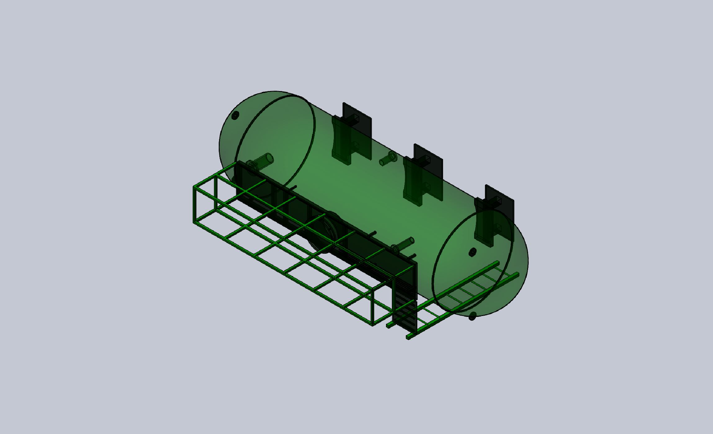
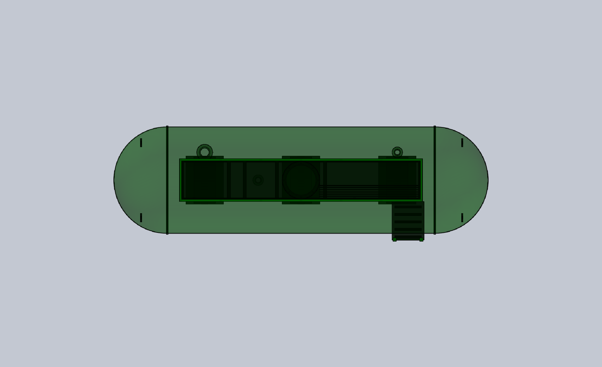
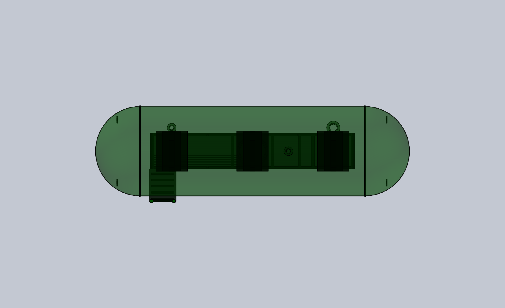
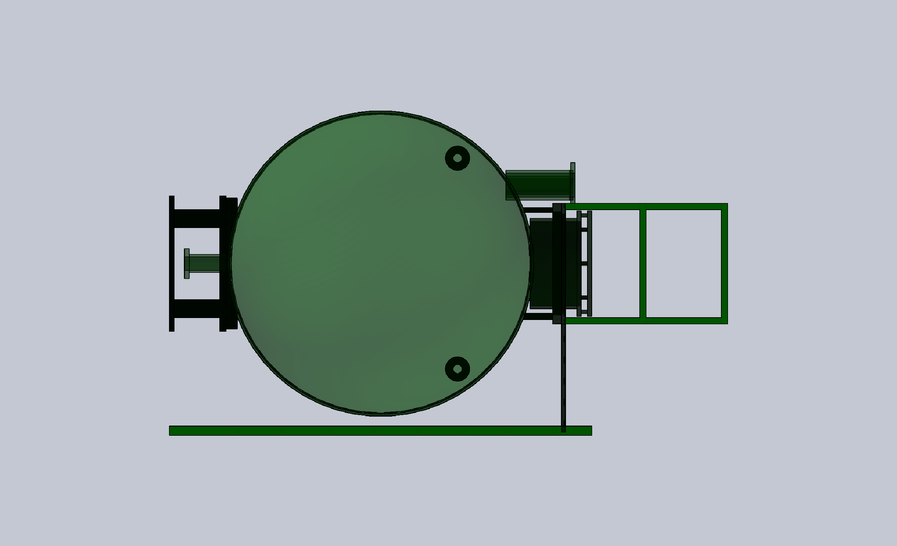
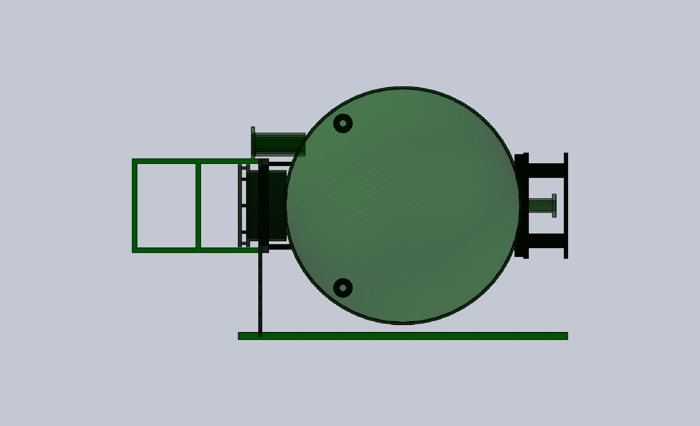
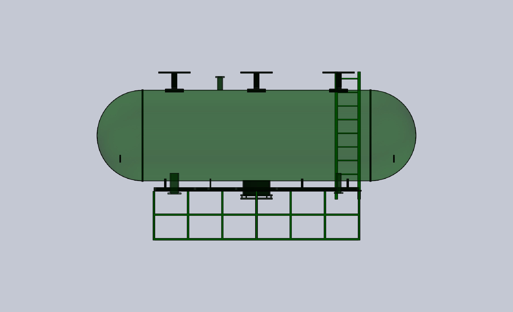
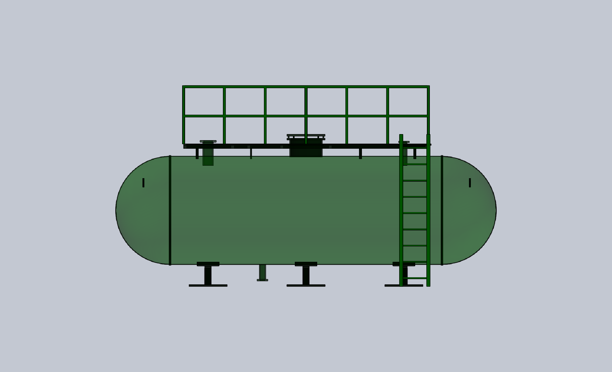

# Case study: horizontal oil-tank assembly

A horizontal oil-storage tank built as a multi-part SolidWorks assembly with
cadmcp: 16 distinct part models, 21 mates, and seven exported orthographic /
isometric views. It exercises the assembly, mate-repair, verification and
export surfaces introduced in 0.4.0.

## At a glance

| Item | Value |
|---|---|
| Part models | 16 distinct `.SLDPRT` sources |
| Placed components | 22 assembly usages in the exported STEP |
| Mates | 21, with 0.0 mm residual shift and all 21 DOF constrained |
| Views | 7 (iso + front / back / left / right / top / bottom) |
| STEP export | ISO-10303-21 AP214, 15 manifold solid BREPs, ~977 KB |

## The brief

The request was a fully modelled horizontal oil-storage tank — real 3D solids,
not a visual mock-up:

- **Shell:** Ø2000 mm × 5000 mm, 8 mm wall; true hemispherical heads (R1000 mm) at both ends; 7000 mm overall length.
- **Supports:** three identical rectangular steel frames along the axis, with curved saddles that follow the shell without penetration.
- **Platform:** 4500 × 800 mm steel frame with grating deck and perimeter guardrails.
- **Access & fittings:** side ladder from ground to platform; manhole, inlet, vent, drain and lifting lugs, all modelled as real solids.
- **Delivery:** split into independent part models, assembled with correct spatial relationships, plus seven views.

Full modeling brief (translated from the original request)

**1. Overall parameters.** Horizontal cylindrical oil tank; axis level; shell
outer diameter 2000 mm; cylindrical section 5000 mm; hemispherical heads at
both ends, 1000 mm deep each; total length 7000 mm; reference wall thickness
8 mm; units mm.

**2. Shell.** Horizontal cylinder with two coaxial true hemispherical heads;
metal/steel construction with reasonable wall thickness; clear annular weld
locations at both ends; elliptical, dished or flat heads are not acceptable
substitutes.

**3. Supports.** Three rectangular steel supports evenly spaced along the axis
(front / middle / rear). Each has two rectangular columns, a bottom base plate
and a curved top saddle that follows the shell without geometric penetration.
All three are identical; all base plates lie in one level plane parallel to the
ground.

**4. Top platform.** Rectangular inspection platform, about 4500 × 800 mm,
along the tank length; steel frame with grating deck; perimeter safety
guardrails made of vertical posts, top handrail and an intermediate rail;
attached to the tank by several steel brackets; level, with no penetration
into the shell.

**5. Side ladder.** Vertical steel ladder on one side, from ground to the top
platform; two parallel rectangular stringers with evenly spaced round rungs;
reasonable width and spacing; connected to the platform entrance; with
necessary safety structures.

**6. Fittings.** Circular manhole at the top centre, made of a short neck,
flange, bolts and a round cover; one inlet nozzle and one vent nozzle on top;
one drain nozzle at the bottom; lifting lugs at both ends. All fittings are
real 3D solids, correctly mounted on the shell.

**7. Part split & assembly.** Split into independent parts and combine them in
a SolidWorks assembly: cylindrical shell, left and right hemispherical heads,
three supports, three curved saddles, platform frame, grating deck, guardrails,
side ladder, manhole, inlet, vent, drain and lifting lugs. Each part has a
clear spatial position and correct assembly relationship.

**8. Modeling quality.** Prefer native SolidWorks features (extrude, revolve,
sweep, pattern, cut); heads must be true geometry, not appearance decals;
guardrails, ladder and supports must be real solids; no suspended, misplaced,
penetrating or wrongly connected parts; no omitted structures; three supports
positioned reasonably and the tank level; platform, guardrails and ladder
properly connected; final output is a complete assembly retaining independent
part models.

**9. Appearance.** Shell silver-grey metal; supports dark-grey steel; platform
dark-grey grating; guardrails and ladder industrial yellow; realistic
industrial-equipment style.

**10. Final delivery.** Complete assembly viewable from front, back, left,
right, top and isometric directions, emphasising correct geometry, complete
heads, reasonable supports, complete platform, correct ladder position and
correct relationships between all parts.

This is the **input brief**, not a claim that every line was met; see the
limitation and notes below.

## What this case exercises

| Capability | Tool(s) |
|---|---|
| List a large assembly without a timeout | `list_components_lite` |
| Insert components, build and repair mates | `insert_component`, `mate`, `fix_components` |
| Check remaining degrees of freedom | `check_assembly_dof` |
| Grouped / partial verification results | `verify_model` |
| Interference volume in explicit units | `check_interference` (`volume_unit`) |
| STEP export | `export` |
| STEP readback contract (Fake backend) | `verify_step_readback` |

!!! note "Known limitation"
    The exported STEP is a valid AP214 file, but **live STEP readback into
    SolidWorks 2025 was not verified**: the COM import path returns `err=1`
    for any STEP file on this host, including a minimal self-exported file,
    and still fails after a controlled restart. The `verify_step_readback`
    tool and its Fake contracts are present; the real-machine readback is
    disclosed as a 0.4.0 environment limitation. Do not read this case as a
    claim that STEP files round-trip in the live SolidWorks backend.

## Views

=== "Isometric"
    

=== "Front"
    

=== "Back"
    

=== "Left"
    

=== "Right"
    

=== "Top"
    

=== "Bottom"
    

## Notes

The assembly and its native files were used for engineering verification and
are not distributed here; only the rendered views are published. Example
assets are provided as-is. SOLIDWORKS® is a registered trademark of Dassault
Systèmes SolidWorks Corporation.
